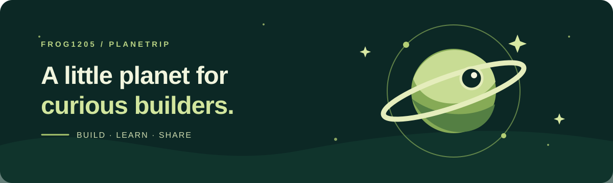

### 你好，我是大风 👋

也叫 **Frog / planetrip**。我在成都做 AI 产品和项目，喜欢把想法变成能用的东西，再把过程分享出来。

这里是我的小小创造星球：一边探索 AI，一边做工具、带着孩子们创造，也记录沿途的发现。

🌱 **我在关注**　AI-native 产品与 Agent · 知识库与工作流 · 青少年 AI 创客教育

🔭 **我的方式**　从真实问题出发，动手做，边用边改，慢慢积累。

### 正在创造的几颗小星球

| | 项目 | 做些什么 |
| :-- | :-- | :-- |
| 🛠️ | [Codex 路由管理工具](https://github.com/Frog1205/codex-three-provider-switcher) | 为 Codex 整理接口切换、连接测试和配置管理。 |
| 🚀 | [AI 游戏创造营](https://github.com/Frog1205/ai-creator-camp) | 用项目式学习，和青少年一起创造 AI 游戏。 |
| 🧭 | [AiCogni](https://github.com/Frog1205/AiCogni) | 记录 AI 思维训练、认知与工具链的探索。 |
| 🌿 | [需求评估助手](https://github.com/Frog1205/demand-evaluator) | 帮小团队梳理 AI 项目需求、交付与风险。 |

### 认识更多的我

**大风 AI 慢游记**记录思考和现场，**工具蛙 Frog**收集实践和工具，**AI 创客家**和青少年一起动手创造。

如果你也在探索 AI 产品、创客教育或有趣的工具，欢迎来逛逛我的[个人主页](https://frog1205.github.io/) 👨‍🚀

成都 · Keep building, keep curious.
